# Alur Sistem: Manajemen Aset Inventaris FTI UKSW

**Dokumen Pelengkap — Visual Flow Guide**
Dibuat sebagai panduan penguji untuk memahami cara kerja sistem secara menyeluruh.
Dokumen ini adalah pasangan dari `Laporan_Kerja.md` dan mencakup seluruh diagram alur proses bisnis, arsitektur teknis, dan keamanan sistem.

> **Cara Membaca Dokumen Ini**
> Setiap bagian menyajikan alur dalam bentuk diagram Mermaid yang dapat di-render langsung di GitHub, VS Code (Markdown Preview), atau tools lain yang mendukung Mermaid.

---

## Daftar Isi

1. [Arsitektur Teknis Sistem](#1-arsitektur-teknis-sistem)
2. [Alur Autentikasi & Manajemen Pengguna](#2-alur-autentikasi--manajemen-pengguna)
3. [RBAC — Matriks & Alur Penjagaan Akses](#3-rbac--matriks--alur-penjagaan-akses)
4. [Alur Registrasi Aset Manual](#4-alur-registrasi-aset-manual)
5. [Alur Import Massal via Excel](#5-alur-import-massal-via-excel)
6. [Alur QR Code & Recovery Aset](#6-alur-qr-code--recovery-aset)
7. [Siklus Hidup Penghapusan Aset](#7-siklus-hidup-penghapusan-aset)
8. [Alur Peminjaman & Pengembalian](#8-alur-peminjaman--pengembalian)
9. [Alur Cashflow & Kelompok Pembelian](#9-alur-cashflow--kelompok-pembelian)
10. [Relasi Entitas Database (ERD Ringkas)](#10-relasi-entitas-database-erd-ringkas)
11. [Alur Log Aktivitas (Audit Trail)](#11-alur-log-aktivitas-audit-trail)
12. [Ringkasan Alur Lengkap Sistem](#12-ringkasan-alur-lengkap-sistem)

---

## 1. Arsitektur Teknis Sistem

Sistem dibangun di atas arsitektur **Full-Stack Serverless-Ready** berbasis Next.js App Router.
Semua permintaan klien melewati lapisan API Route Handlers sebelum menyentuh database.

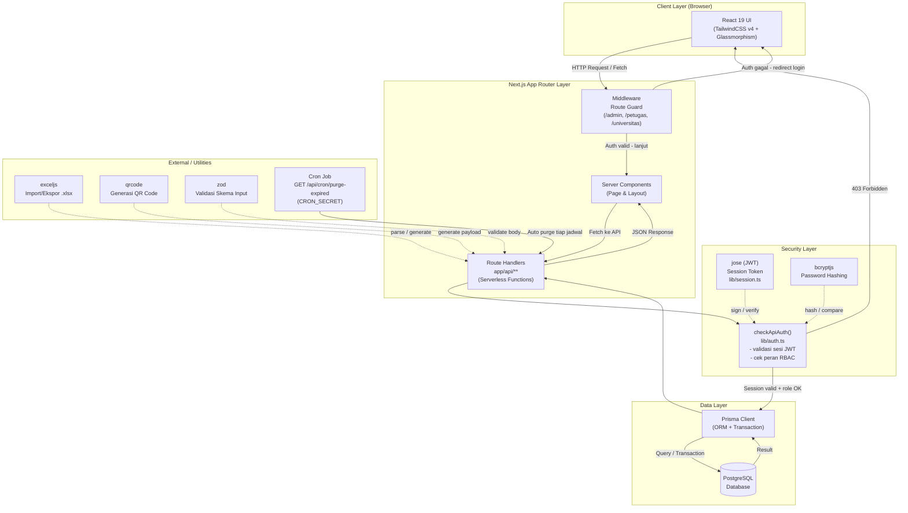

**Catatan Penting:**
- **Middleware** bekerja di edge — menolak akses halaman sebelum rendering jika tidak ada sesi valid
- **checkApiAuth()** adalah "penjaga kedua" di level API — UI hiding saja tidak cukup, setiap endpoint mutasi memverifikasi peran secara independen
- **Prisma Transaction** digunakan untuk operasi multi-tabel agar konsistensi data terjaga (atomik)

---

## 2. Alur Autentikasi & Manajemen Pengguna

### 2.1. Registrasi & Aktivasi Akun Baru

Sistem menggunakan **Closed-Environment Registration** — pengguna baru tidak langsung aktif.

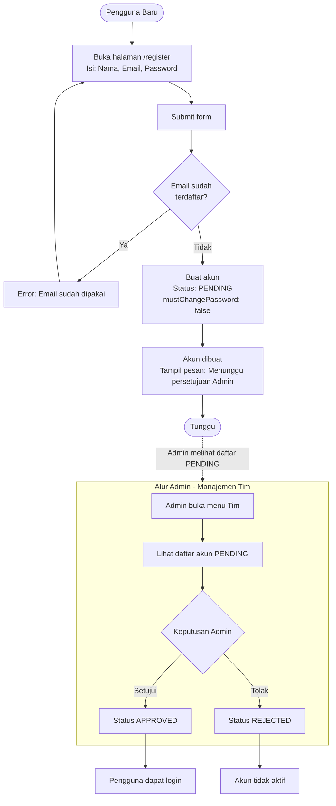

### 2.2. Alur Login & Force Password Change

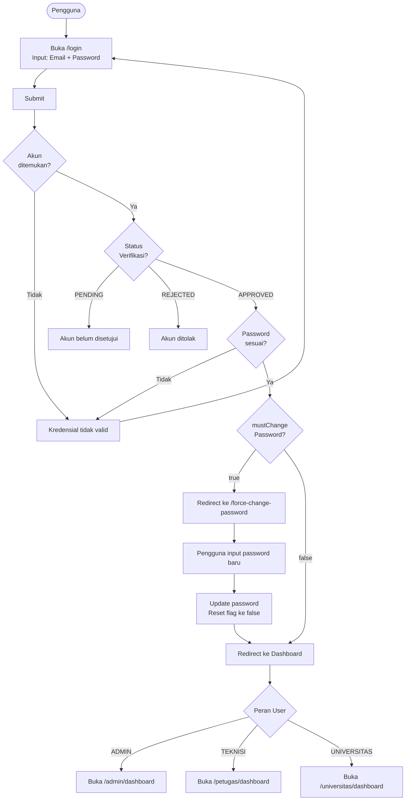

### 2.3. Alur Reset Password oleh Admin

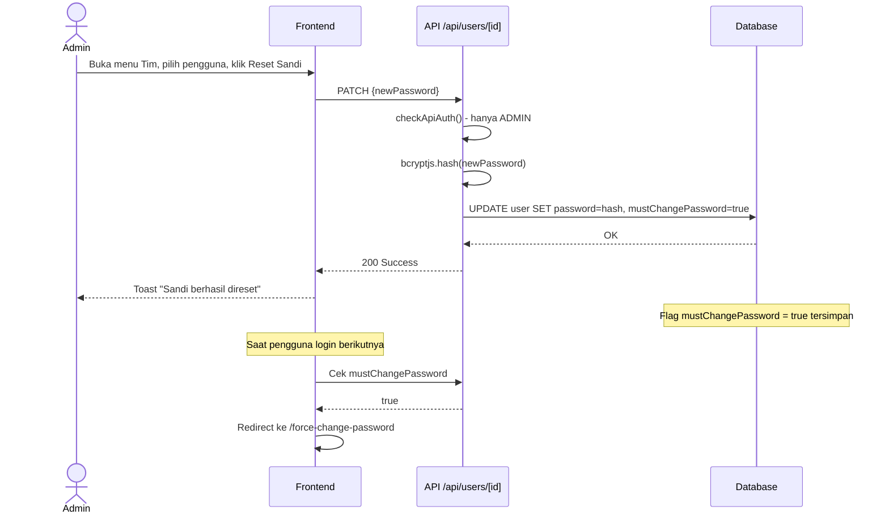

---

## 3. RBAC — Matriks & Alur Penjagaan Akses

### 3.1. Alur Penjagaan Akses (Double Guard)

Setiap permintaan melewati **dua lapis penjagaan** yang saling independen.

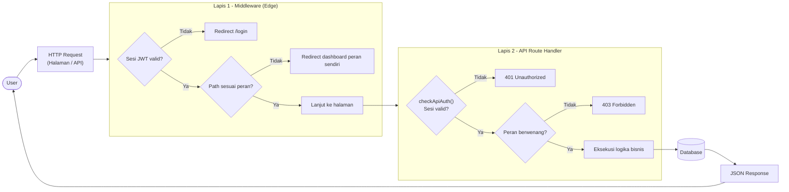

### 3.2. Ringkasan Hak Akses per Peran

| Operasi | ADMIN | TEKNISI | UNIVERSITAS |
|:---|:---:|:---:|:---:|
| Lihat Barang | ALLOW | ALLOW | ALLOW |
| Tambah / Edit Barang | ALLOW | ALLOW | DENY |
| Soft Delete Barang | ALLOW | DENY | DENY |
| Hard Delete Barang | ALLOW | DENY | DENY |
| Restore Barang | ALLOW | ALLOW | DENY |
| Pindah Ruangan | ALLOW | ALLOW | DENY |
| Buat / Selesaikan Peminjaman | ALLOW | ALLOW | DENY |
| Lihat Cashflow | ALLOW | ALLOW | READ ONLY |
| Mutasi Cashflow | ALLOW | DENY | DENY |
| Lihat Log Aktivitas | ALLOW | ALLOW (aksi TEKNISI) | DENY (403) |
| Kelola Pengguna & Tim | ALLOW | DENY | DENY |
| Import Massal | ALLOW | DENY | DENY |

---

## 4. Alur Registrasi Aset Manual

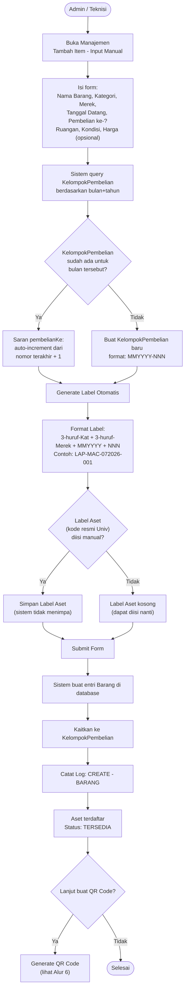

---

## 5. Alur Import Massal via Excel

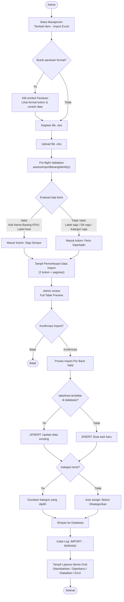

---

## 6. Alur QR Code & Recovery Aset

### 6.1. Generate & Cetak QR Code

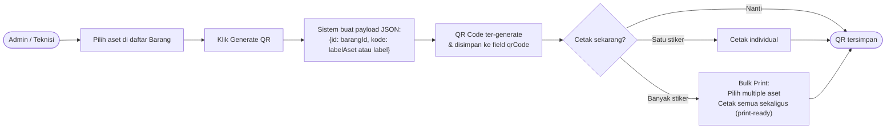

### 6.2. Alur Scan QR & 5 State Recovery

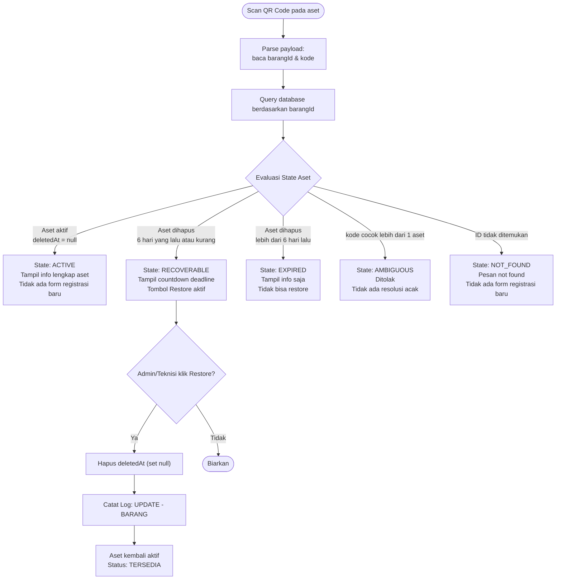

---

## 7. Siklus Hidup Penghapusan Aset

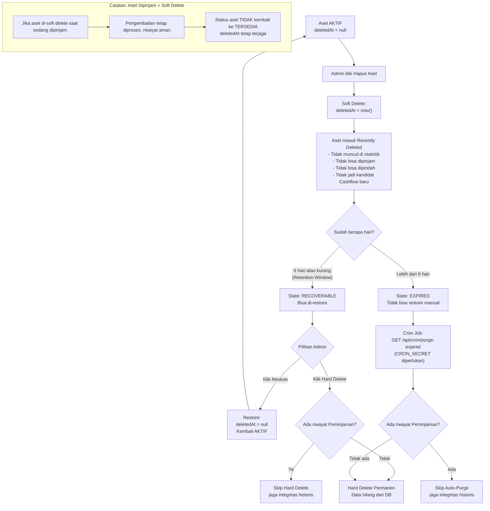

---

## 8. Alur Peminjaman & Pengembalian

### 8.1. Proses Peminjaman

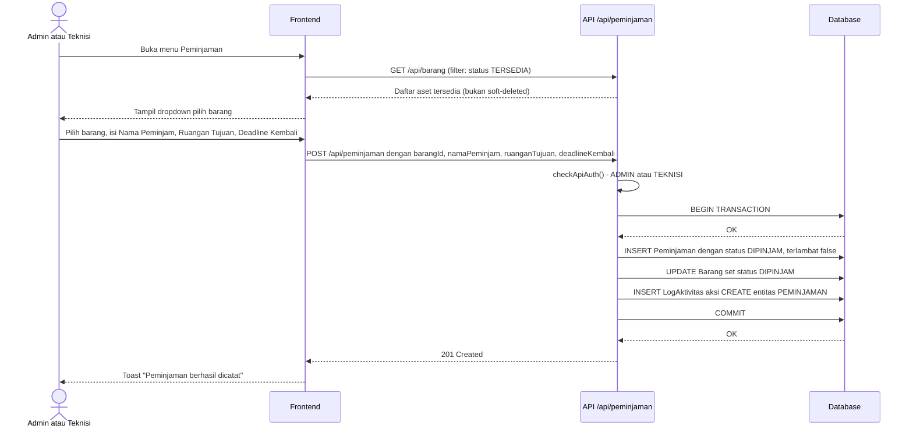

### 8.2. Proses Pengembalian

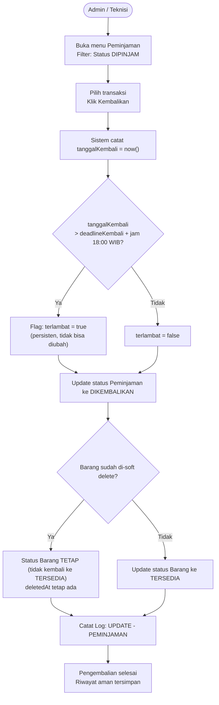

---

## 9. Alur Cashflow & Kelompok Pembelian

### 9.1. Tambah Pengeluaran Baru

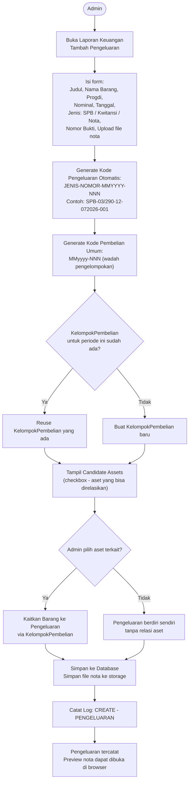

### 9.2. Sinkronisasi Dua Arah (Two-Way Sync)

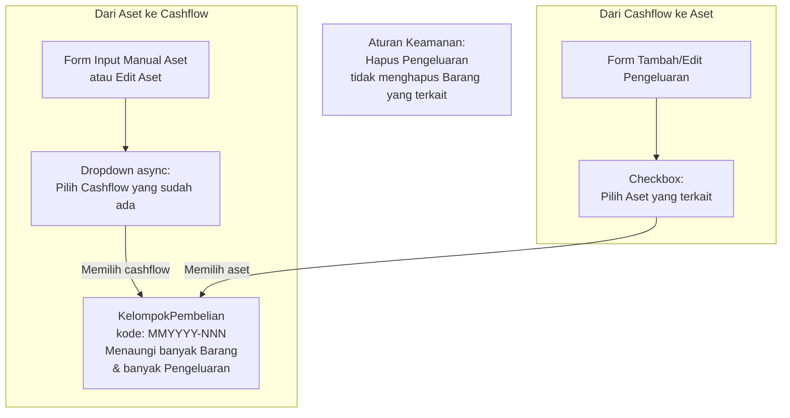

---

## 10. Relasi Entitas Database (ERD Ringkas)

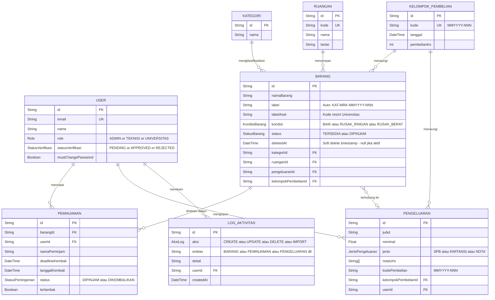

**Catatan Relasi Penting:**

| Relasi | Penjelasan |
|:---|:---|
| `BARANG ? PENGELUARAN` | Opsional: satu aset bisa punya satu bukti cashflow, satu cashflow bisa tanpa aset |
| `KELOMPOK_PEMBELIAN ? BARANG` | Satu KelompokPembelian menaungi banyak aset (satu periode pembelian) |
| `KELOMPOK_PEMBELIAN ? PENGELUARAN` | Satu KelompokPembelian bisa punya banyak bukti bayar (SPB, Kwitansi, Nota) |
| `deletedAt` | Soft delete — aset dengan nilai ini dikecualikan dari semua alur operasional |

---

## 11. Alur Log Aktivitas (Audit Trail)

### 11.1. Mekanisme Pencatatan Log

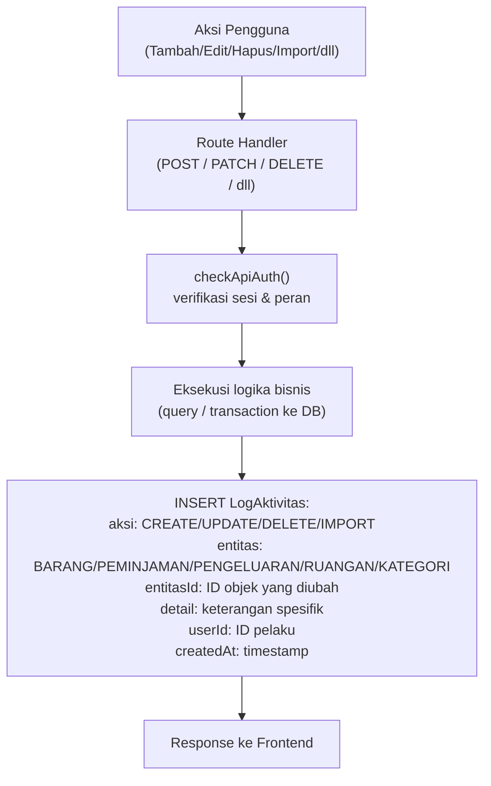

### 11.2. Visibilitas Log per Peran

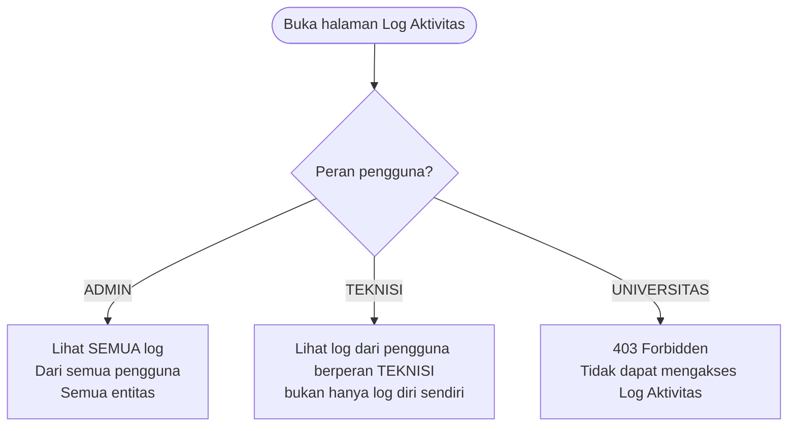

### 11.3. Cakupan 18 Operasi yang Dicatat

| No | Operasi | Entitas | Aksi Log |
|:---:|:---|:---|:---|
| L1 | Tambah Barang | BARANG | CREATE |
| L2 | Edit Barang | BARANG | UPDATE |
| L3 | Pindah Ruangan | BARANG | UPDATE |
| L4 | Soft Delete Barang | BARANG | DELETE |
| L5 | Restore Barang | BARANG | UPDATE |
| L6 | Hard Delete Barang | BARANG | DELETE |
| L7 | Import Massal Barang | BARANG | IMPORT |
| L8 | Buat Peminjaman | PEMINJAMAN | CREATE |
| L9 | Pengembalian | PEMINJAMAN | UPDATE |
| L10 | Tambah Cashflow | PENGELUARAN | CREATE |
| L11 | Edit Cashflow | PENGELUARAN | UPDATE |
| L12 | Hapus Cashflow | PENGELUARAN | DELETE |
| L13 | Tambah Ruangan | RUANGAN | CREATE |
| L14 | Edit Ruangan | RUANGAN | UPDATE |
| L15 | Hapus Ruangan | RUANGAN | DELETE |
| L16 | Tambah Kategori | KATEGORI | CREATE |
| L17 | Edit Kategori | KATEGORI | UPDATE |
| L18 | Hapus Kategori | KATEGORI | DELETE |

---

## 12. Ringkasan Alur Lengkap Sistem

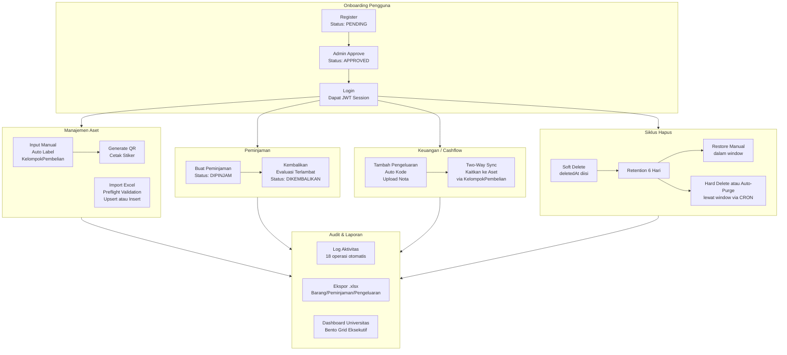

---

*Dokumen ini adalah bagian dari Laporan Kerja Sistem Manajemen Aset Inventaris FTI UKSW.*
*Dibaca bersama dengan `Laporan_Kerja.md` untuk pemahaman teknis yang lengkap.*
*Commit Final: `713c57d` — Rilis Final, Juli 2026.*
