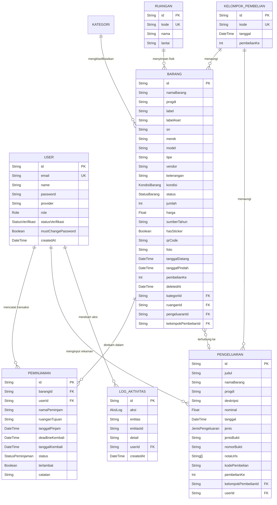

# Laporan Kerja: Sistem Manajemen Aset Inventaris FTI UKSW

**Judul Proyek:** Perancangan dan Implementasi Sistem Informasi Manajemen Aset Inventaris Berbasis Web untuk Fakultas Teknologi Informasi Universitas Kristen Satya Wacana (UKSW)
**Versi Sistem:** Rilis Final (Revisi Terakhir: Juli 2026)
**Commit Final:** `713c57d` — *fix: complete activity logs and role permissions*
**Repository:** ChaserHades/fti-uksw · Branch: `main`

---

## 1. Pendahuluan

### 1.1. Latar Belakang

Pengelolaan aset inventaris fisik di lingkungan perguruan tinggi, khususnya Fakultas Teknologi Informasi UKSW, selama ini masih mengandalkan metode pencatatan manual berupa spreadsheet yang tidak terpusat dan rawan kesalahan. Tidak adanya sistem terpadu menyebabkan aset sulit dilacak, peminjaman tidak tercatat dengan benar, serta audit keuangan memerlukan waktu lama karena data tidak tersinkronisasi antara bagian operasional dan pihak eksekutif universitas.

### 1.2. Tujuan Sistem

Sistem ini dirancang untuk mendigitalisasi dan mensentralisasi seluruh tata kelola aset inventaris fisik (komputer, periferal, furnitur, dan peralatan lainnya) beserta pencatatan keuangan/pengeluaran operasional di lingkungan FTI UKSW. Sistem bertujuan untuk:

- Mengeliminasi pencatatan manual yang rawan kesalahan dan kehilangan data
- Memberikan visibilitas *real-time* terhadap seluruh inventaris untuk semua pemangku kepentingan
- Memfasilitasi proses audit keuangan dan inventaris yang cepat dan akurat bagi pihak Universitas
- Memastikan akuntabilitas setiap pergerakan aset melalui jejak audit (*audit trail*) yang lengkap
- Mempercepat proses pengadaan aset dengan alur kerja yang terstandarisasi

### 1.3. Cakupan Sistem

Sistem memfasilitasi siklus hidup aset secara penuh: dari pengadaan (registrasi *Cashflow*/Pengeluaran), pendaftaran aset (pembuatan kode label & QR), pemindahan lokasi (Mutasi Ruangan), peminjaman dan pengembalian, hingga pelaporan eksekutif untuk pihak Universitas, termasuk mekanisme pemusnahan (*soft delete*, *hard delete*) dan pemulihan aset.

---

## 2. Arsitektur Teknis (*Tech Stack*)

Aplikasi dibangun menggunakan arsitektur web modern dengan paradigma **Full-Stack Serverless-Ready**:

| Komponen | Teknologi | Versi |
| :--- | :--- | :--- |
| Framework Utama | Next.js (App Router) | 16.2.6 |
| Runtime | React | 19.2.4 |
| Bahasa | TypeScript | ^5 |
| Database | PostgreSQL | — |
| ORM | Prisma Client | 7.9.1 |
| UI Styling | TailwindCSS v4 + Vanilla CSS (Glassmorphism) | ^4.3.0 |
| Autentikasi Sesi | jose (JWT) | ^5.9.6 |
| Enkripsi Sandi | bcryptjs | ^2.4.3 |
| Ekspor/Impor Excel | exceljs | ^4.4.0 |
| Generasi QR Code | qrcode | ^1.5.4 |
| Notifikasi UI | react-hot-toast | ^2.4.1 |
| Ikon | lucide-react | ^1.16.0 |
| Validasi Skema | zod | ^3.23.8 |
| Kontainerisasi | Docker + Docker Compose | — |

### 2.1. Pola Arsitektur API

Seluruh *backend* diimplementasikan menggunakan **Next.js Route Handlers** (`app/api/`), berjalan sebagai fungsi *serverless*. Pola yang digunakan:

- **Cursor-based Pagination:** untuk semua daftar data bervolume besar (Barang, Peminjaman, Pengeluaran)
- **Transaction Atomicity:** operasi mutasi yang melibatkan lebih dari satu tabel dibungkus dalam `prisma.$transaction()` untuk menjamin konsistensi data
- **Centralized Auth Guard:** seluruh rute API dilindungi oleh fungsi `checkApiAuth()` di `lib/auth.ts` yang mengelola validasi sesi dan hak akses secara terpusat

---

## 3. Manajemen Pengguna & Hak Akses (RBAC)

Keamanan operasional diatur dengan konsep *Role-Based Access Control* (RBAC) yang ketat, diterapkan di dua lapis: **API Guard** di *backend* dan **UI Guard** di *frontend*. UI hiding saja tidak dianggap cukup — setiap mutasi data dilindungi oleh pengecekan peran di sisi server.

### 3.1. Matriks Peran (Permission Matrix)

| Operasi | ADMIN | TEKNISI | UNIVERSITAS |
| :--- | :---: | :---: | :---: |
| Lihat Barang | ALLOW | ALLOW | ALLOW |
| Tambah Barang | ALLOW | ALLOW | DENY |
| Edit Barang | ALLOW | ALLOW | DENY |
| Soft Delete Barang | ALLOW | DENY | DENY |
| Restore Barang | ALLOW | ALLOW | DENY |
| Hard Delete Barang | ALLOW | DENY | DENY |
| Pindah Ruangan | ALLOW | ALLOW | DENY |
| Buat Peminjaman | ALLOW | ALLOW | DENY |
| Proses Pengembalian | ALLOW | ALLOW | DENY |
| Lihat Cashflow/Pengeluaran | ALLOW | ALLOW | READ ONLY |
| Mutasi Cashflow | ALLOW | DENY | DENY |
| Lihat Log Aktivitas | ALLOW | ALLOW | DENY |
| Kelola Pengguna & Tim | ALLOW | DENY | DENY |
| Import Massal Aset | ALLOW | DENY | DENY |

### 3.2. Definisi Peran

| Peran | Profil Pengguna |
| :--- | :--- |
| **ADMIN** | Admin fakultas: otoritas penuh terhadap seluruh data, termasuk keuangan, tim, dan aset. |
| **TEKNISI** | Petugas lapangan: operasional harian (scan, pindah barang, catat peminjaman). Tidak dapat mengakses keuangan atau menghapus permanen. |
| **UNIVERSITAS** | Auditor/Rektorat: hanya membaca laporan inventaris dan keuangan. Tidak dapat mengubah data apapun. |

### 3.3. Alur Autentikasi Khusus

- **Registrasi Tertutup (*Closed-Environment*):** Pengguna baru tidak bisa langsung aktif. Status default adalah `PENDING`, dan harus disetujui oleh Admin menjadi `APPROVED`.
- **Status Penolakan:** Admin dapat menolak (`REJECTED`) akun yang tidak valid.
- **Force Password Change:** Ketika Admin mereset sandi staf, sistem menandai *flag* `mustChangePassword = true`. Pengguna tersebut dipaksa mengganti sandi di halaman *login* berikutnya sebelum dapat mengakses sistem.

---

## 4. Desain Basis Data & ERD

Sistem menggunakan normalisasi basis data dengan integritas referensial penuh. Terdapat **8 model utama** dan **6 enum**:

### 4.1. Model Data

**User** — Pengguna sistem dengan peran dan status verifikasi
**Barang** — Entitas aset inventaris (dengan soft delete via `deletedAt`)
**Ruangan** — Lokasi fisik penyimpanan aset (kode, nama, lantai)
**Peminjaman** — Transaksi peminjaman aset
**Pengeluaran** — Catatan cashflow/pengeluaran dengan bukti pembayaran
**KelompokPembelian** — Pengelompokan aset dan pengeluaran dalam satu periode pembelian
**Kategori** — Klasifikasi aset
**LogAktivitas** — Jejak audit operasional

### 4.2. Diagram Relasi Entitas



### 4.3. Kendala Bisnis (*Business Constraints*)

- **Soft Delete Safety:** Barang yang di-*soft delete* (`deletedAt != null`) dikecualikan secara otomatis dari semua statistik operasional (dashboard), tidak dapat dipinjam, tidak dapat dipindah, dan tidak dapat menjadi kandidat *Cashflow* baru.
- **Return Without Resurrection:** Jika barang di-*soft delete* saat sedang dalam status dipinjam, proses pengembalian tetap diselesaikan (riwayat aman), namun status barang **tidak** dikembalikan ke `TERSEDIA` — `deletedAt` tetap terjaga.
- **Purchase Group:** Model `KelompokPembelian` menaungi relasi M:N secara implisit antara banyak `Barang` dan banyak `Pengeluaran` dalam satu periode/kode pembelian yang sama (format: `MMYYYY-NNN`).
- **Relational Protection:** `Pengeluaran` yang dihapus tidak menghapus `Barang` yang terkait.
- **History Preservation:** `Peminjaman` yang sudah ada mencegah `Barang` dari *hard delete* otomatis saat purge, untuk menjaga integritas data historis.

---

## 5. Alur Proses Bisnis Utama

### 5.1. Registrasi Aset Baru (Manual)

1. Admin/Teknisi membuka menu **Manajemen → Tambah Item → Input Manual**
2. Input wajib: **Nama Barang, Kategori, Merek, Tanggal Datang, Pembelian ke-?**
3. Sistem secara otomatis meng-*query* `KelompokPembelian` berdasarkan bulan+tahun yang dipilih, dan menyarankan urutan *pembelianKe* berikutnya (auto-increment dari pembelian terakhir pada bulan tersebut)
4. Kode **Label** digenerate otomatis: `{3 huruf Kategori}-{3 huruf Merek}-{MMYYYY}-{NNN}`. Contoh: *Kategori Laptop, Merek MacBook, Juli 2026, Pembelian ke-1* → **LAP-MAC-072026-001**
5. **Label Aset** (kode inventaris resmi dari Universitas) diisi secara manual jika tersedia — sistem tidak menimpa kode ini
6. Sistem membuat entri `KelompokPembelian` baru (atau me-*reuse* yang sudah ada), mengaitkan `Barang` ke dalamnya, dan mencatat log aktivitas `CREATE`

### 5.2. Registrasi Massal via Import Excel

1. Admin membuka menu **Manajemen → Tambah Item → Import Excel**
2. Mengklik **Panduan** untuk melihat petunjuk format kolom yang valid dan contoh data
3. Admin mengunggah file `.xlsx`. Sistem melakukan *Pre-flight Validation*:
   - Baris **valid**: memiliki minimal *Nama Barang* ATAU *Label Aset*
   - Baris **tidak valid**: *Label saja*, *SN saja*, *Kategori saja*, atau kombinasi tanpa anchor identitas
4. Hasil ditampilkan di **Pemeriksaan Data Import** (dua kolom: "Perlu Diperbaiki" / "Siap Diimpor") dengan paginasi
5. Pada layar **Full Table Preview**, Admin dapat melihat semua baris sebelum push
6. Setelah dikonfirmasi, sistem memproses import: *upsert* berdasarkan `labelAset` jika tersedia, atau *insert* baru
7. Kategori kosong pada baris valid → otomatis ditetapkan ke **"Belum Dikategorikan"**
8. Hasil akhir ditampilkan dalam laporan *Bento Grid*: jumlah Ditambahkan, Diperbarui, Diabaikan, Error

### 5.3. QR Code & Identitas Aset

1. Setelah aset terdaftar, Admin/Teknisi men-*generate* QR Code. Payload berformat JSON: `{"id": "<barangId>", "kode": "<labelAset|label>"}`
2. Fitur **Cetak Massal (Bulk Print)** memungkinkan mencetak puluhan stiker QR sekaligus
3. **Scan QR untuk Recovery:** Saat QR dipindai pada aset yang sudah terhapus, alur *recovery* aktif dengan 5 state:
   - **ACTIVE** → menampilkan info barang, tidak ada form registrasi baru
   - **RECOVERABLE** (<=6 hari) → menampilkan countdown deadline, tombol restore
   - **EXPIRED** (>6 hari) → hanya info, tidak bisa restore
   - **AMBIGUOUS** (label lama cocok lebih dari 1 aset) → ditolak, tidak ada resolusi acak
   - **NOT_FOUND** → hanya pesan not found, tidak ada form registrasi baru

### 5.4. Siklus Penghapusan Aset (*Deletion Lifecycle*)

1. **Soft Delete:** Admin menghapus aset → `deletedAt` diisi *timestamp*. Aset masuk ke "Recently Deleted"
2. **Retention Window:** 6 hari (144 jam) dari `deletedAt`
3. **Restore:** Dalam 6 hari, Admin/Teknisi dapat memulihkan ke `Barang` yang sama (ID tidak berubah)
4. **Hard Delete:** Admin dapat menghapus permanen aset yang sudah di-*soft delete* (jika tidak ada riwayat `Peminjaman`)
5. **Auto-Purge:** Cron job `GET /api/cron/purge-expired` (dilindungi `CRON_SECRET`) menjalankan *hard delete* otomatis untuk aset yang sudah lewat 6 hari. Aset dengan riwayat peminjaman di-*skip*

### 5.5. Peminjaman & Pengembalian

1. Admin/Teknisi membuka menu **Peminjaman**, memilih barang, mengisi nama peminjam, ruangan tujuan, dan *deadline* kembali
2. Status barang langsung berubah ke `DIPINJAM`, tercatat dalam log aktivitas
3. Saat dikembalikan, sistem mengevaluasi apakah pengembalian melewati *deadline* + jam 18:00 WIB → *flag* `terlambat = true` bersifat persisten
4. Barang yang di-*soft delete* saat sedang dipinjam: pengembalian tetap diproses, tapi barang tidak otomatis kembali ke `TERSEDIA`

### 5.6. Cashflow & Kelompok Pembelian (Two-Way Sync)

1. Admin membuka menu **Laporan Keuangan → Tambah Pengeluaran**
2. Mengisi: judul, nama barang, Progdi, nominal, tanggal, jenis pengeluaran, jenis bukti pembayaran (SPB/Kwitansi/Nota), nomor bukti, dan file nota (JPG/PDF/DOCX)
3. Kode pengeluaran dibentuk otomatis: `{JENIS_BUKTI}-{NOMOR_BUKTI}-{MMYYYY}-{NNN}`. Contoh: **SPB-03/290-12-072026-001**
4. Kode pembelian umum (`MMYYYY-NNN`) berfungsi sebagai "wadah" untuk mengelompokkan semua bukti pembayaran dan aset pada periode yang sama
5. **Sinkronisasi Dua Arah:**
   - Dari **Aset ke Cashflow:** Saat input manual aset, dapat dipilih *Cashflow* yang sudah ada (dropdown async) untuk mengaitkan aset ke bukti pembayaran terkait
   - Dari **Cashflow ke Aset:** Saat membuat/edit pengeluaran, sistem menampilkan *candidate assets* yang dapat dipilih via *checkbox* untuk langsung direlasikan
6. Preview nota dapat dibuka langsung di browser (responsif), dengan navigasi *horizontal scroll* jika lebih dari 1 nota

---

## 6. Fitur-Fitur Sistem

### 6.1. Dashboard Eksekutif Multi-Peran

- **Admin & Teknisi Dashboard:** Statistik operasional real-time — total aset aktif, status peminjaman (aktif/terlambat), distribusi kondisi barang, distribusi kategori, ringkasan pengeluaran
- **Universitas Dashboard:** Dashboard eksekutif berbasis *Bento Grid* 12-kolom — total inventaris, kondisi aset, total pengeluaran dalam terbilang Rupiah, daftar aset terbaru, distribusi kategori top-5, dan **Aset Perlu Perhatian** (sorted: Rusak Berat dahulu, lalu Rusak Ringan) agar prioritas pengadaan dapat teridentifikasi langsung oleh pihak Universitas

### 6.2. Manajemen Aset Terpadu

- **Daftar Barang** dengan pencarian multi-parameter, filter kondisi/status/ruangan/kategori, dan sort berdasarkan kode cashflow
- **BarangDetailModal** (shared, read-only): digunakan di semua peran — menampilkan semua field relevan (Nama, Kategori, Status, Kondisi, Label, Label Aset, SN, Merek, Model, Tipe, Progdi, Ruangan, Tanggal Datang, Pembelian ke, Keterangan, Harga) beserta bukti pengeluaran terkait
- **Status Badge** ditampilkan langsung di sebelah nama barang
- **Kolom Progdi** untuk mengidentifikasi aset milik Program Studi mana (D3/S1/S2/S3 FTI UKSW)

### 6.3. Fitur QR Code & Cetak Massal

- QR Code digenerate per aset dengan payload berbasis ID internal (`barang.id`)
- **Bulk Print:** Mencetak banyak stiker QR sekaligus dalam format *print-ready*
- **Unprinted Counter:** Menampilkan jumlah aset yang belum memiliki stiker QR

### 6.4. Log Aktivitas (Audit Trail)

Sistem mencatat **18 jenis operasi** secara otomatis ke tabel `LogAktivitas`, mencakup entitas Barang, Peminjaman, Pengeluaran, Ruangan, dan Kategori:

| No | Operasi | Aksi Log |
| :---: | :--- | :--- |
| L1 | Tambah Barang | CREATE - BARANG |
| L2 | Edit Barang | UPDATE - BARANG |
| L3 | Pindah Ruangan | UPDATE - BARANG (nama ruangan tujuan tercatat di `detail`) |
| L4 | Soft Delete Barang | DELETE - BARANG |
| L5 | Restore Barang | UPDATE - BARANG |
| L6 | Hard Delete Barang | DELETE - BARANG |
| L7 | Import Massal Barang | IMPORT - BARANG |
| L8 | Buat Peminjaman | CREATE - PEMINJAMAN |
| L9 | Pengembalian | UPDATE - PEMINJAMAN |
| L10 | Tambah Cashflow/Pengeluaran | CREATE - PENGELUARAN |
| L11 | Edit Cashflow/Pengeluaran | UPDATE - PENGELUARAN |
| L12 | Hapus Cashflow/Pengeluaran | DELETE - PENGELUARAN |
| L13 | Tambah Ruangan | CREATE - RUANGAN |
| L14 | Edit Ruangan | UPDATE - RUANGAN |
| L15 | Hapus Ruangan | DELETE - RUANGAN |
| L16 | Tambah Kategori | CREATE - KATEGORI |
| L17 | Edit Kategori | UPDATE - KATEGORI |
| L18 | Hapus Kategori | DELETE - KATEGORI |

**Aturan Visibilitas Log:**
- **ADMIN:** melihat semua log
- **TEKNISI:** melihat semua log milik aktor berperan TEKNISI (bukan hanya log diri sendiri)
- **UNIVERSITAS:** tidak dapat mengakses Log Aktivitas (403 Forbidden)

### 6.5. Ekspor Data

- **Ekspor Barang:** file `.xlsx` berisi seluruh data inventaris
- **Ekspor Peminjaman:** file `.xlsx` berisi riwayat peminjaman
- **Ekspor Pengeluaran:** file `.xlsx` berisi catatan keuangan
- **Ekspor Terfilter:** ekspor mengikuti filter/pencarian yang sedang aktif (*Unified Export Modal*)

### 6.6. Manajemen Ruangan

- CRUD ruangan lengkap (kode, nama, lantai)
- Statistik jumlah aset per ruangan
- Pemindahan aset antar ruangan dicatat dalam log

### 6.7. Manajemen Kategori & Tim

- CRUD kategori aset
- Admin dapat melihat, menambah, mengedit, dan menonaktifkan akun pengguna
- Reset sandi dengan mekanisme *force relogin*

---

## 7. Keamanan & Integritas Sistem

### 7.1. Proteksi Berlapis

1. **Middleware Route Guard:** Halaman `/admin`, `/petugas`, dan `/universitas` dijaga oleh Server Components yang memverifikasi sesi sebelum merender konten
2. **API-Level Auth Guard:** Fungsi `checkApiAuth()` di setiap *route handler* memvalidasi sesi dan menolak akses yang tidak sesuai peran dengan HTTP **403 Forbidden**
3. **Permission Enforcement:** Setiap endpoint mutasi memeriksa peran di sisi server secara independen — UI hiding saja tidak cukup

### 7.2. Integritas Data

4. **Transaction Atomicity:** Operasi multi-tabel dibungkus dalam satu `prisma.$transaction()` — jika satu gagal, semua di-*rollback*
5. **Deleted Asset Safety (Batch 2A):** Aset yang di-*soft delete* dikecualikan dari seluruh alur operasional: tidak bisa dipinjam, tidak dihitung di statistik, tidak bisa dipindah, tidak menjadi kandidat Cashflow baru
6. **No Native Browser Dialogs:** Semua konfirmasi pengguna menggunakan `ConfirmModal` kustom

### 7.3. Keamanan Kredensial

7. **Password Hashing:** Semua sandi di-*hash* satu arah menggunakan `bcryptjs` (salted hash)
8. **JWT Session:** Sesi dikelola menggunakan `jose` (JWT)
9. **Force Relogin:** *Flag* `mustChangePassword` memaksa penggantian sandi saat Admin melakukan reset

### 7.4. Validasi Input

10. **Import Identity Validation:** Setiap baris import dievaluasi oleh `assessImportBarangIdentity()` — baris tanpa anchor identitas ditolak sebelum masuk database
11. **Anomaly Detection:** Parser mendeteksi nilai kategori yang hanya berisi simbol/karakter tidak lazim
12. **File Type Guard:** Import hanya menerima `.xlsx`, upload nota hanya menerima ekstensi yang diizinkan (jpg, pdf, docx, dll)
13. **CRON Secret Guard:** Endpoint purge hanya dapat dipanggil dengan `Authorization: Bearer {CRON_SECRET}` yang valid

---

## 8. Desain Responsif & UX

### 8.1. Breakpoint yang Diuji

Sistem diuji pada breakpoint: **375px** (mobile), **430px**, **768px** (tablet), **1024px**, dan **1440px** (desktop).

### 8.2. Perilaku Responsif

- Tabel data menggunakan *horizontal scroll* internal (`table-wrap`) — tidak ada *overflow* yang merusak layout halaman
- Modal dialog menyesuaikan viewport (maks 90vh tinggi, *overflow-y: auto* untuk konten panjang)
- Topbar responsif dengan menu yang dapat di-*collapse* di mobile
- *Bento Grid* dashboard melipat ke layout satu kolom di bawah 1024px

### 8.3. UX Presentation States

Setiap komponen data menangani tiga *state* dengan tampilan yang layak:
- **Loading:** Skeleton loader atau *spinner* di dalam container
- **Empty:** Pesan kosong yang informatif dengan ikon
- **Error:** Pesan error yang jelas tanpa mengekspos detail teknis ke pengguna

---

## 9. Riwayat Pengembangan & Milestone

Pengembangan dilakukan secara bertahap (*batch-based development*) dengan *locked milestones*:

| Commit | Batch | Deskripsi |
| :--- | :--- | :--- |
| `5edb70a` | Batch 1A | Refactor aturan identitas import & item interaktif |
| `a0e9e02` | Batch 1B | Asset recovery, siklus soft delete, QR identity |
| `a644b6a` | Batch 3A | Peningkatan alur presentasi Universitas |
| `06306da` | Merge | Merge branch main, baseline sync |
| `c50cb04` | Batch 3B | Polish import, responsive presentation UX |
| `ead1b81` | Batch 2A | Isolasi aset terhapus dari alur operasional |
| `713c57d` | **Batch 2B (FINAL)** | Kelengkapan log aktivitas & verifikasi role permissions |

---

## 10. Indikator Keberhasilan Sistem

Tabel berikut merangkum hasil verifikasi terhadap seluruh fungsionalitas sistem pada kondisi rilis final:

| No | Indikator | Status |
| :---: | :--- | :---: |
| 1 | Build produksi berhasil (TypeScript, Next.js) | PASS |
| 2 | Prisma schema valid & client tergenerasi | PASS |
| 3 | Format label otomatis (KAT-MRK-MMYYYY-NNN) benar | PASS |
| 4 | Label tidak wajib unik (berbagi label diperbolehkan) | PASS |
| 5 | Label Aset (kode inventaris resmi) tidak ditimpa sistem | PASS |
| 6 | Input manual: 5 kolom prioritas + auto-suggest pembelianKe | PASS |
| 7 | Purchase Group (KelompokPembelian) terbentuk otomatis | PASS |
| 8 | Import validitas: 7 kombinasi valid, 8 kombinasi invalid | PASS |
| 9 | Import: kategori kosong -> "Belum Dikategorikan" | PASS |
| 10 | Import: labelAset sebagai anchor upsert utama | PASS |
| 11 | Import: label saja / SN saja tidak auto-merge | PASS |
| 12 | Import Preview: validasi per baris individual | PASS |
| 13 | QR Code payload berbasis barang.id internal | PASS |
| 14 | QR Recovery: 5 state (ACTIVE/RECOVERABLE/EXPIRED/AMBIGUOUS/NOT_FOUND) | PASS |
| 15 | Siklus 6 hari deletion window enforcement | PASS |
| 16 | Soft-delete aset tidak mengganggu statistik operasional | PASS |
| 17 | Pengembalian peminjaman tidak "menghidupkan" aset yang dihapus | PASS |
| 18 | 18 operasi log aktivitas tercakup (Barang, Peminjaman, Pengeluaran, Ruangan, Kategori) | PASS |
| 19 | Log TEKNISI: melihat log semua aktor berperan TEKNISI | PASS |
| 20 | Log UNIVERSITAS: akses ditolak (403 Forbidden) | PASS |
| 21 | UNIVERSITAS: tidak ada aksi mutasi (API & UI) | PASS |
| 22 | Cashflow: multiple bukti per Kelompok Pembelian | PASS |
| 23 | Two-way sync: Aset <-> Cashflow via KelompokPembelian | PASS |
| 24 | Hapus Pengeluaran tidak menghapus Barang terkait | PASS |
| 25 | Tidak ada window.confirm / window.alert di produksi | PASS |
| 26 | Seluruh rute aplikasi dapat diakses (auth redirect normal) | PASS |
| 27 | Universitas dashboard: Rusak Berat diprioritaskan pertama | PASS |
| 28 | BarangDetailModal: shared, read-only, digunakan semua peran | PASS |
| 29 | Cron purge: history-safe, fail-closed dengan CRON_SECRET | PASS |
| 30 | Tidak ada file sementara/debug di repository | PASS |

**Hasil Keseluruhan: 30/30 indikator terpenuhi — Sistem dinyatakan SIAP PRODUKSI untuk cakupan yang telah dirancang.**

> *Catatan revisi: Laporan ini diperbarui pada Agustus 2026 berdasarkan audit langsung terhadap source code untuk mengoreksi jumlah model database (7→8, menambahkan Ruangan), jumlah operasi log (12→18, menambahkan RUANGAN & KATEGORI), field Barang yang tidak terdokumentasi, dan struktur direktori komponen.*

---

## 11. Struktur Direktori Proyek

```
fti-uksw/
├── app/                         # Next.js App Router
│   ├── admin/                   # Halaman ADMIN
│   │   ├── dashboard/           # Dashboard admin
│   │   ├── manajemen/           # Manajemen aset, peminjaman, tim
│   │   └── tim/                 # Manajemen pengguna
│   ├── petugas/                 # Halaman TEKNISI
│   │   ├── dashboard/
│   │   └── manajemen/
│   ├── universitas/             # Halaman UNIVERSITAS (read-only)
│   │   ├── dashboard/           # Bento Grid eksekutif
│   │   ├── barang/
│   │   └── manajemen/
│   ├── api/                     # Route Handlers (Backend API)
│   │   ├── barang/              # CRUD, Import, Export, QR, Recovery
│   │   ├── peminjaman/          # Borrow & Return
│   │   ├── pengeluaran/         # Cashflow & Evidence
│   │   ├── ruangan/             # Room management
│   │   ├── kategori/            # Category management
│   │   ├── log/                 # Activity log
│   │   ├── dashboard/stats/     # Dashboard metrics
│   │   ├── users/               # User management
│   │   └── cron/purge-expired/  # Auto-purge expired deleted assets
│   ├── login/, register/        # Auth pages
│   └── force-change-password/   # Force reset flow
├── components/
│   ├── features/                # Feature-level components
│   │   ├── barang/              # BarangDetailModal, DaftarBarangTab, BarangFormFields,
│   │   │                        # AddItemTab, ManualAddSection, ScanRegisterSection,
│   │   │                        # ImportSection, KategoriTab
│   │   ├── BarangManager.tsx    # Wrapper tab manajemen barang
│   │   ├── ImportDraftView.tsx  # Pemeriksaan Data Import (preflight)
│   │   ├── FullTablePreview.tsx # Full Table Preview sebelum push
│   │   ├── LaporanManager.tsx   # Cashflow management
│   │   ├── PinjamManager.tsx    # Peminjaman management
│   │   ├── RuanganManager.tsx   # Ruangan management
│   │   ├── RecentlyDeletedView.tsx # Tampilan aset terhapus (recovery)
│   │   ├── RiwayatManager.tsx   # Riwayat peminjaman
│   │   ├── UnifiedExportModal.tsx  # Modal ekspor terfilter (Barang/Peminjaman/Pengeluaran)
│   │   └── LogAktivitasView.tsx # Activity log viewer
│   └── (shared UI components)   # Modal, Topbar, TabSwitcher, dll
├── lib/                         # Core libraries
│   ├── auth.ts                  # checkApiAuth()
│   ├── session.ts               # getSession() / JWT
│   ├── prisma.ts                # Prisma client singleton
│   ├── excel-parser.ts          # XLSX parser (semantic column mapping)
│   ├── import-barang-identity.ts # Import identity validator
│   ├── purchase-code.ts         # MMYYYY-NNN code generator
│   └── resolveRelations.ts      # resolveKategori() & resolveRuangan() — resolve by ID/nama/kode, auto-create jika tidak ada
├── prisma/
│   └── schema.prisma            # Database schema (8 models, 6 enums)
├── docs/
│   └── Laporan_Kerja.md         # Dokumen ini
├── Dockerfile
├── docker-compose.yml
└── package.json
```

---

## 12. Panduan Deployment

### 12.1. Persyaratan

- Node.js >= 18 / Bun runtime
- PostgreSQL database (lokal atau cloud)
- File `.env` berisi: `DATABASE_URL`, `JWT_SECRET`, `CRON_SECRET`

### 12.2. Langkah Deployment (Development)

```bash
# 1. Install dependencies
bun install

# 2. Setup database
bun run db:push

# 3. Generate Prisma client
bun run db:generate

# 4. (Opsional) Seed data awal
bun run db:seed

# 5. Jalankan dev server
bun run dev
# -> http://localhost:3000
```

### 12.3. Build Produksi

```bash
bun run build   # prisma generate + next build
bun run start   # jalankan production server
```

### 12.4. Deployment via Docker

```bash
docker-compose up --build -d
```

---

*Dokumen ini mencerminkan kondisi sistem pada rilis final commit `713c57d` dan merupakan bukti implementasi Sistem Informasi Manajemen Aset Inventaris FTI UKSW yang telah selesai dirancang, diimplementasikan, diuji, dan disiapkan untuk produksi.*
